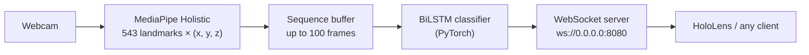

# Sign-Language-GISLR

**Word-level sign language recognition from body landmarks, streamed to a HoloLens over WebSocket.**

> **Part of [HoloAssist](https://github.com/MarcoNoLimits/Bootstrap)**, a HoloLens 2 app that gives people with non-functional hearing live subtitles, English ↔ Italian translation and ASL fingerspelling recognition. HoloAssist reads *fingerspelled letters*; this repo explores the next step, recognising *whole signs*. Graduation project (FENS 402), Kadir Has University, 2026.

**Status:** research prototype. The pipeline runs end to end on a laptop webcam; trained weights aren't included in the repo.

## How it works



1. **Landmarks** (`extractor.py`): MediaPipe Holistic gives 468 face, 33 pose and 21 + 21 hand landmarks per frame. They're ordered face, left hand, pose, right hand to match the Kaggle dataset layout, and missing parts are zero-filled.
2. **Buffer** (`buffer.py`): keeps the last 100 frames and zero-pads shorter sequences into a `[1, 100, 543, 3]` tensor.
3. **Model** (`model.py`): a linear embedding of each frame (1629 → 256), a 3-layer bidirectional LSTM, then global max pooling over time so the zero-padded frames don't drag the result down, and a dense classifier.
4. **Inference** (`model_engine.py`): runs once at least 30 frames are buffered, at most every 2 seconds, and returns the top sign in upper case with its confidence, for example `HELLO (0.87)`.
5. **Server** (`server.py`): broadcasts each prediction to every connected client as JSON: `{"id": "...", "text": "HELLO (0.87)", "timestamp": 1711200000.0}`. It also opens a local window with the landmarks drawn, for debugging.

## Training

`train.py` trains on the Kaggle **Google – Isolated Sign Language Recognition** dataset (`asl-signs`, parquet landmark files) inside a Kaggle notebook. It currently trains on a 10-sign subset for 20 epochs (AdamW, learning rate 3e-4, plateau scheduler, Gaussian jitter and random rotation of the landmarks as augmentation) and saves a checkpoint after every epoch, plus `weights_10class.pth` and `sign_map_10.json` at the end.

`sign_to_prediction_index_map.json` is the dataset's full 250-sign vocabulary.

## Running it

Python 3.10 or newer and a webcam.

```bash
pip install -r requirements.txt

# Start the server (opens the webcam and a debug window; Esc to quit)
python server.py

# In another terminal, print what the server sends
python test_client.py
```

`ModelEngine` loads `checkpoint_epoch_15.pth` with the 250-sign vocabulary by default. Without weights it still runs with a randomly initialised network, which is enough to test the pipeline. To use the 10-sign weights from `train.py`, pass them with their matching vocabulary:

```python
ModelEngine(weights_path="weights_10class.pth", vocab_path="sign_map_10.json")
```

## Files

| File | Purpose |
|---|---|
| `extractor.py` | Webcam capture and MediaPipe Holistic landmark extraction |
| `buffer.py` | Sliding frame buffer and tensor conversion |
| `model.py` | `GISLRTransformer` model (embedding + BiLSTM + classifier) |
| `model_engine.py` | Loads weights and vocabulary, runs inference |
| `server.py` | WebSocket server and inference loop |
| `test_client.py` | Minimal client that prints received predictions |
| `train.py` | Kaggle training script |
| `BaseImplementation_plan` | The original design notes for this backend |
